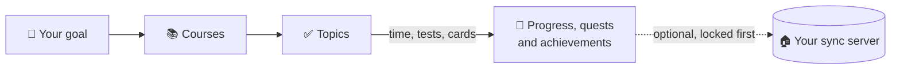

<h1 align="center">
  <br>
  <a href="https://github.com/sudharamachandranrajeev/vidya"></a>
  <br>
  Vidya
  <br>
</h1>

<h4 align="center">Plan what you want to learn, study a little every day, remember it, and show what you can do.</h4>

<p align="center">
  <a href="https://github.com/sudharamachandranrajeev/vidya/releases"></a>
  
  
  <a href="https://github.com/sudharamachandranrajeev/brahma"></a>
</p>

<p align="center">
  <a href="#-what-it-does">What it does</a> •
  <a href="#-get-started">Get started</a> •
  <a href="#-how-it-works">How it works</a> •
  <a href="#-faq-and-troubleshooting">FAQ</a> •
  <a href="#%EF%B8%8F-for-developers">For developers</a>
</p>

<p align="center">
  
</p>

Vidya is a calm study companion for self-learners: a new career, a certification, a degree or a
pile of books. It turns a big goal into small steps, keeps a gentle daily habit, and shows real
progress. Status: **early test releases**. It needs no internet and no account.

## ✨ What it does

- 🗺️ **A plan for any goal** – a goal holds courses, and each course holds topics. Start from a
  template (software engineer, data analyst, cloud and DevOps) or write your own.
- ⏱️ **Focus timer and study log** – run a quiet 15 to 60 minute timer, or log time by hand.
  Record test scores as you go.
- 🃏 **Flashcards that stick** – cards come back just before you would forget them (spaced
  repetition). See what is due today and this week.
- 📈 **Skills and gaps** – rate each skill 0 to 5 and set a target. The gap is your to-do list.
- 🏆 **A portfolio** – projects, certificates, talks and degrees, each linked to the skills it
  proves. Copy it all as text for a CV.
- 📝 **Notes** – a searchable knowledge base with tags.
- 📊 **Progress you did not type in** – study time, streaks, scores, retention and a weekly chart,
  all worked out from what you record.
- 🌱 **Quietly game-like** – three small quests a day, levels from Seed to Sage and 34
  achievements. No noise, no nagging.
- 🔒 **Private by design** – data is encrypted on the device. Sync is optional, and one account
  works in every Brahma app.

<details>
<summary>How experience and levels work</summary>

Experience comes from topics, study time (capped per day), tests, courses, programs (goals),
skill levels, portfolio items, notes, cards and reviews (capped per day) and achievements. Level
*n* starts at 50·n·(n−1) experience. Achievements unlock once and stay. Flashcards use a
day-by-day SM-2 schedule: **Again** brings a card back today; **Good** and **Easy** push it
further out each time.
</details>

## 📸 Screenshots

<table>
  <tr>
    <td align="center"><br><sub>Home</sub></td>
    <td align="center"><br><sub>Review</sub></td>
    <td align="center"><br><sub>Progress</sub></td>
  </tr>
  <tr>
    <td align="center"><br><sub>Achievements</sub></td>
    <td align="center"><br><sub>Home (dark)</sub></td>
    <td align="center"><br><sub>Home on a desktop</sub></td>
  </tr>
</table>

<p align="center">
  <br>
  <sub>Progress on a desktop window</sub>
</p>

<sub>All screenshots show a made-up learner, rendered from the app's code.</sub>

## 🚀 Get started

### Step 1 – Download

Open the [releases page](https://github.com/sudharamachandranrajeev/vidya/releases) and, under
the newest release, pick the file for your device:

| Your device | File to download | Works on |
| --- | --- | --- |
| 🐧 Linux computer | `Vidya-<version>-linux-x64.tar.gz` | Ubuntu 24.04, Fedora, Arch and similar (64-bit x86) |
| 🪟 Windows computer | `Vidya-<version>-windows-x64-setup.exe` | Windows 10 and 11 |
| 🤖 Android phone | `Vidya-<version>-android.apk` | Android 7 and newer |

Each release also has `SHA256SUMS.txt`, a list of fingerprints to check the files are genuine.

### Step 2 – Install

<details>
<summary><b>🐧 Linux</b></summary>

1. Open a terminal in the folder where the download landed.
2. Unpack it and run the installer as your normal user (not `sudo`):
   ```sh
   tar -xzf Vidya-*-linux-x64.tar.gz
   cd vidya-*-linux-x64 && ./install.sh
   ```
3. Open **Vidya** from your app menu.

It installs for your user only. It needs GTK 3, libsecret and the desktop keyring (the app that
stores passwords) running. To remove it later: `./install.sh --uninstall`. Your data stays.

</details>

<details>
<summary><b>🪟 Windows</b></summary>

1. Double-click `Vidya-<version>-windows-x64-setup.exe`. No admin rights needed.
2. Windows may say *"Windows protected your PC"*. This appears because the app isn't paid-signed
   yet, not because it is harmful. Click **More info → Run anyway**.
3. Follow the installer, then open **Vidya** from the Start menu.

Prefer no installer? Download `…-windows-x64-portable.zip`, unzip it anywhere and run `vidya.exe`.

</details>

<details>
<summary><b>🤖 Android</b></summary>

1. Open the downloaded `.apk` on your phone.
2. If Android asks, allow installs from your browser or file manager. This is normal for apps
   from outside an app store.
3. Tap **Install**, then **Open**.

Newer versions install over the top and keep your data.

</details>

### Step 3 – First launch

Vidya opens on **Home**, with today's quests. Every screen works empty.

1. **Make a plan**: open **Learn** and tap **Use a template**, or **New program** to write your
   own goal. A single course without a goal? Tap **Course outside a program**.
2. **Study**: tap **Focus** at the top of **Home** and pick a length. The time is logged when it
   ends. Or open a course and tap **Log time**.
3. **Tick off topics** on the course page. The course and the goal move on by themselves.
4. **Add flashcards**: on **Review**, tap **Card**. Come back daily and tap **Begin review**.

> [!NOTE]
> The next release opens with a short welcome. It asks where your data should live: on this
> device only, or synced through a home or cloud server. It also adds an app lock (PIN or
> fingerprint), **Ask AI** for help finding your way, **Report a problem**, and a notice when a
> new version is out.

### Step 4 (optional) – Use it on more than one device

Turn on sync in **Settings → Sync**. You need a sync server you own; the
[Brahma sync server guide](https://github.com/sudharamachandranrajeev/brahma/tree/main/server)
walks you through it. **Write down the recovery key** it shows and keep it safe.

## 🧭 How it works



- **Everything is built from what you record.** Finish topics and the course moves on; finish
  every course and the goal is done.
- **On each device**, Vidya keeps your data in an encrypted database. Without your key it is
  unreadable.
- **Vidya makes no network requests of its own.** It talks to your sync server only if you sign
  in. The next release also asks GitHub once a day for a newer version (you can switch this off).

> [!IMPORTANT]
> Your password and recovery key are the only ways to unlock synced data. If you lose both, nobody
> can recover it. On Android, uninstalling the app deletes its data, so sync first.

## ❓ FAQ and troubleshooting

<details>
<summary><b>Do I need an account or the internet?</b></summary>

No. Vidya works fully offline on one device. You only need a server if you want sync.
</details>

<details>
<summary><b>Windows says the app might be unsafe</b></summary>

The build isn't code-signed (a paid certificate). Click **More info → Run anyway**. Check the file
against `SHA256SUMS.txt` on the release if you want to be sure it is genuine.
</details>

<details>
<summary><b>Linux: Vidya stops at start and talks about a missing key</b></summary>

The key that unlocks your data lives in the desktop keyring. Make sure your keyring app is
running and unlocked, then start Vidya again.
</details>

<details>
<summary><b>I missed a day. Is my streak gone?</b></summary>

The streak restarts, but your longest streak, experience, level and achievements stay. Quests are
small on purpose: one short focus session is enough to start again.
</details>

<details>
<summary><b>Where is my data stored?</b></summary>

Linux: `~/.local/share/dev.brahma.vidya`. Windows: in your user's AppData folder. Android: inside
the app. Uninstalling on Linux or Windows leaves it in place.
</details>

## 🛠️ For developers

<details>
<summary>Build from source, test and release</summary>

You need [Git](https://git-scm.com) and [Flutter](https://flutter.dev) 3.47.

```bash
git clone https://github.com/sudharamachandranrajeev/vidya
cd vidya
flutter pub get
dart run build_runner build -d   # generate the database code
flutter run -d linux             # or windows, or an Android device

flutter test && dart format -l 110 lib test                       # test and format
VIDYA_SHOTS=/tmp/shots flutter test test/screenshots_test.dart    # render the screenshots
scripts/make-icons.sh                                             # app icons from branding/
```

- `brahma_core` comes from the [brahma](https://github.com/sudharamachandranrajeev/brahma) repo.
  To work on both at once, add a `pubspec_overrides.yaml` (ignored by git) pointing at
  `../brahma/core`.
- The plan structure (program, course, topic, assessment) follows the ERPNext education module.
- CI runs on each push. A `v*` tag builds, smoke-tests and publishes the Android, Windows and
  Linux builds (`.github/workflows/release.yml`).
- Changes per version: [CHANGELOG.md](CHANGELOG.md).

</details>

<details>
<summary>Credits</summary>

- [Flutter](https://flutter.dev) and [Riverpod](https://riverpod.dev)
- [drift](https://drift.simonbinder.eu) over [SQLite3MultipleCiphers](https://utelle.github.io/SQLite3MultipleCiphers/)
  for the encrypted database
- [url_launcher](https://pub.dev/packages/url_launcher) and [intl](https://pub.dev/packages/intl)
- The [ERPNext](https://erpnext.com) education module, as the model for programs, courses and topics
- Fonts [Inter](https://rsms.me/inter/) and [Plus Jakarta Sans](https://github.com/tokotype/PlusJakartaSans),
  bundled under the SIL Open Font License

</details>

## Related

Vidya is one app in the **Brahma** family. They share one sign-in and one sync server.

| App | What it does |
| --- | --- |
| [brahma](https://github.com/sudharamachandranrajeev/brahma) | The shared core and the all-in-one app |
| [artha](https://github.com/sudharamachandranrajeev/artha) | Money: accounts, spending, bills and investments |
| [graha-anveshana](https://github.com/sudharamachandranrajeev/graha-anveshana) | Find a home to rent or buy |
| [vahana-anveshana](https://github.com/sudharamachandranrajeev/vahana-anveshana) | Find a car |
| [udyoga](https://github.com/sudharamachandranrajeev/udyoga) | Career and job hunting |

## License

No licence has been chosen yet; all rights reserved.

---

> GitHub [@sudharamachandranrajeev](https://github.com/sudharamachandranrajeev)
